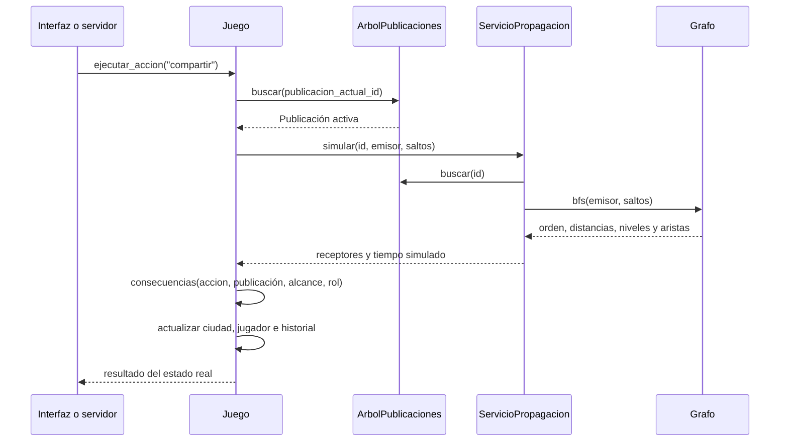

> Pulido visual vigente: [guía](pulido_visual.md) y [452 pruebas verificadas](verificacion_pulido_visual.md).

# Arquitectura de CIVICA

## Responsabilidades

`estructuras/` implementa el ABB y el grafo; no importa PyQt ni dibuja. `models/` define los datos del dominio. `juego/` combina estructuras, decisiones, eventos, puntuación y resultado electoral. `red/` llama el mismo motor desde el servidor. `interfaz/` presenta el estado y entrega las acciones a ese motor.

`infraestructura.recursos.RAIZ` identifica la carpeta del proyecto. `audio/` reproduce sonido durante la partida y `audiovisual/` contiene los renderizadores empleados para producir los videos.

El antiguo archivo `interfaz.py` se dividió en aplicación, ventana, escenas y componentes. `paneles.py` se separó en visualizador de grafo, escena de red y diálogos. Imports, pruebas y herramientas apuntan a cada módulo nuevo. `main.py`, `iniciar.py` y `python -m interfaz` abren la misma aplicación; la demostración anterior de `main.py` está en `ejemplos/demo_abb.py`.

## Árbol y grafo en una decisión

El motor recupera la publicación del ABB antes de procesar la decisión. Si ya fue retirada, no puede volver a circular. Los ciudadanos son vértices del grafo; las publicaciones son elementos del ABB. Retirar contenido conserva las personas y sus relaciones.

La elección utiliza los receptores conservados en el historial para calcular los apoyos. Por eso modificar una arista antes de compartir puede cambiar tanto las consecuencias inmediatas como el resultado electoral.

## Estructuras y costos

El [ABB](../estructuras/bst.py) es propio, no autoequilibrado, con llave `Publicación.id` y referencias `izquierda` y `derecha`. Insertar, buscar y eliminar cuestan O(h), donde h es la altura; el peor caso es O(n). Los recorridos cuestan O(n). La eliminación cubre hoja, un hijo y dos hijos; en este último caso utiliza el sucesor mínimo del subárbol derecho. No se implementa AVL.

El [grafo](../estructuras/grafo.py) es dirigido y utiliza diccionarios de adyacencia. Una arista A → B permite propagar de A hacia B. BFS emplea una cola FIFO y obtiene distancias mínimas en número de saltos; DFS emplea una pila LIFO y explora en profundidad. Sin límite de profundidad ambos recorridos cuestan O(V + E). El grafo no tiene pesos; el camino mínimo se obtiene con BFS.

El tiempo de propagación se calcula como la distancia máxima alcanzada multiplicada por el intervalo del rol. Es una simulación del modelo, no una medida de latencia TCP. El emisor ocupa el nivel cero y no cuenta como receptor.

## Persistencia y comunicación

[`Juego.datos`](../juego/partida.py) guarda las publicaciones activas en preorden, los vértices, las aristas, los jugadores, el historial y el estado del generador aleatorio. `Juego.desde_datos` reinserta las publicaciones en ese orden y reconstruye las relaciones; conserva así la forma del ABB y la continuación de la partida.

[`red/servidor.py`](../red/servidor.py) conserva el estado oficial y serializa las decisiones. [`red/cliente.py`](../red/cliente.py) transmite mensajes sin bloquear la interfaz; [`red/protocolo.py`](../red/protocolo.py) define las tramas. Los clientes presentan una réplica del estado; el servidor aplica las reglas y sincroniza los resultados.

## Evidencia y límites

`python -B -m ejemplos.demo_integracion` ejecuta el motor sin abrir ventanas y comprueba la relación causal entre topología, alcance, indicadores, puntos y elección. Las pruebas de integración también comprueban la forma del árbol tras guardar/restaurar y el bloqueo de una publicación retirada.

La suite automatizada se ejecuta con `herramientas/verificar_proyecto.py`. Su informe actual debe consultarse antes de citar cantidades de pruebas. Los documentos y videos de versiones anteriores conservan su valor histórico; no constituyen una validación nueva de esta reorganización.

La [matriz de entrega](entrega_final.md) registra los pendientes de roles, repositorio y revisión humana.

## Integración vigente de la novela

La entrada principal crea VentanaNovela, subclase de VentanaPrincipal, y conserva sus escenas originales. interfaz/novela agrega expediente, controles ilustrados, sala y planos. SesionInvestigacion coordina los hallazgos y llama Juego.ejecutar_accion: las publicaciones siguen en ArbolPublicaciones y la difusión sigue calculandose mediante Grafo.bfs y ServicioPropagacion.

El recorrido principal utiliza red/cooperativa.py y red/cliente_cooperativo.py para dos roles exclusivos. interfaz/novela/cooperativa.py reconstruye la presentación original y conserva su identidad mientras permanece en el mismo acto. La vista de investigación se filtra por participante; el servidor mantiene el estado oficial.

La [guía actual](novela.md) y la [verificación final](verificacion_novela.md) documentan los seis actos y las pruebas terminadas. Los modulos de red anteriores permanecen como compatibilidad de las campañas originales.
