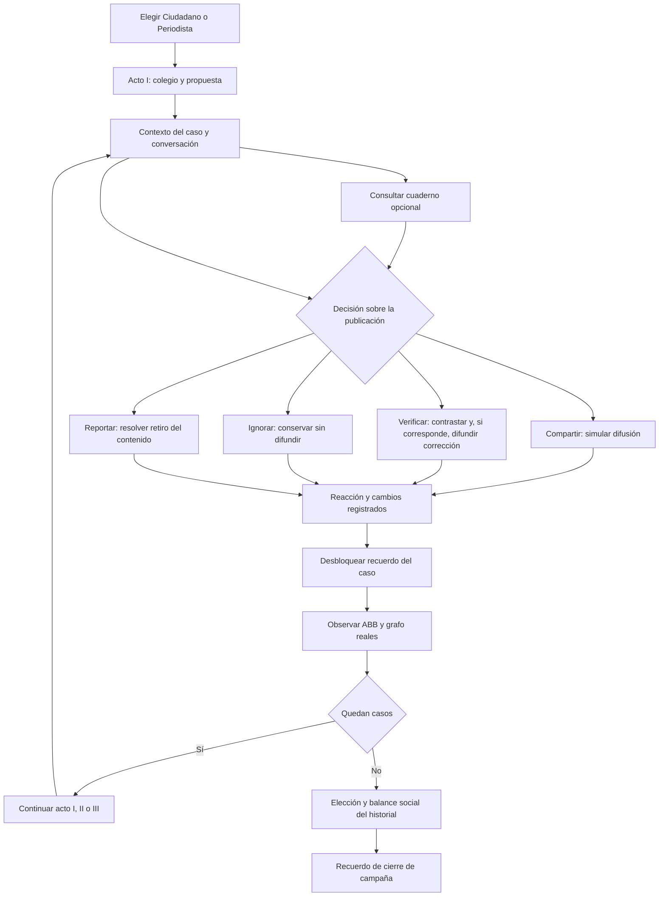

# CIVICA: diseño de la novela visual

La campaña completa añade los actos IV a VII, ocho decisiones, Valeria Cruz y las cuatro candidaturas con diálogo. Su guion, fuentes, ramas y desenlaces se describen en [guion_siete_actos.md](guion_siete_actos.md). El diseño de tres actos que sigue documenta la campaña clásica, conservada para partidas anteriores; sus límites de producción describen aquella versión.

Este documento traduce la guía «¿Cómo crear una novela visual? (Principios, mecánica y plantilla)» facilitada por el usuario en el diseño integrado en CIVICA el 24 de octubre de 2026. Describe el arco narrativo, los personajes, el cuaderno y las mecánicas de lectura. `juego/cuaderno.py` reúne los contenidos, `juego/historia.py` deriva las reacciones del historial y `novela_ui.py` presenta el cuaderno. Las ampliaciones artísticas futuras se identifican por separado. Los requisitos del laboratorio y las reglas del proyecto tienen prioridad sobre las sugerencias generales de la guía.

## Premisa y experiencia buscada

En Ciudad Nova, una campaña electoral llega al Café Central a través de Civitas. Un ciudadano quiere ayudar a su barrio; una periodista intenta contrastar antes de que cada mensaje se convierta en una certeza compartida. Seis publicaciones obligan a decidir entre compartir, verificar, ignorar y reportar. La elección cambia tanto los vínculos cotidianos como el balance de la campaña. El conflicto es reconocible: querer cuidar a alguien y, por apresurarse, terminar amplificando algo que puede perjudicarlo.

La novela visual es un drama cívico con investigación breve y simulación de difusión. El ABB guarda las publicaciones y el grafo representa a sus posibles receptores. Cada estructura participa en lo que sucede, y la historia da un motivo para observarlas. La partida conserva los IDs y las cuatro acciones existentes. Leer el cuaderno es opcional: sus documentos orientan la atención y no contienen preguntas de conocimiento, respuestas evaluadas ni un examen previo a decidir.

Objetivo de ritmo: intercambios breves, una situación humana concreta, hasta tres pistas opcionales y una decisión con una reacción reconocible. Se busca que los personajes recuerden la forma de actuar del jugador y que el cierre permita reconstruir sus decisiones. La mejora depende de esos vínculos y consecuencias, además de la cantidad de elementos visibles.

## Mundo y límites de coherencia

- **Ciudad Nova** es la ciudad ficticia; **Civitas**, su red social. El Café Central permite detenerse y conversar; la mesa de investigación permite leer documentos; el observatorio permite seguir los mensajes.
- El tiempo se expresa como jornadas de campaña. Las fechas y los documentos del cuaderno son ficción interna y no se presentan como fuentes de política real.
- Las publicaciones conservan el contenido de `data/publicaciones.json`: colegio, nueva propuesta, parque, biblioteca, rumor y encuesta. Las pistas amplían su contexto sin cambiar su veracidad ni la puntuación.
- Una fuente original y un testimonio tienen funciones diferentes. La emoción de un vecino explica el riesgo humano de la decisión; por sí sola no confirma un hecho.
- Los fondos existentes son ambientes ilustrados. Las descripciones evitan exigir que una imagen muestre un edificio específico que no aparece en el recurso.
- Se conservan dos roles seleccionables: Ciudadano y Periodista. Los cuatro candidatos son personajes del mundo; no se amplía la selección de roles.

## Tres actos

| Acto | Casos originales | Conflicto y propósito narrativo | Cierre de acto propuesto |
|---|---|---|---|
| I · Una ciudad que escucha | #50 colegio; #30 propuesta de Adrián | Un mensaje sobre el colegio alcanza una preocupación familiar. La propuesta siguiente permite distinguir anuncio, documento y opinión. El jugador aprende las acciones actuando sobre situaciones. | En el café se nota si las primeras conversaciones ganaron cuidado o urgencia. La periodista debe ganarse la confianza del ciudadano. |
| II · Lo que compartimos | #70 parque; #20 biblioteca | También hay información útil: se trata de conservar horarios, etapas y límites al compartirla. La red crece y hace visibles más personas afectadas. | Una decisión útil puede facilitar la vida cotidiana; una reacción infundada también puede frenar información valiosa. Los personajes comparan lo ocurrido con el primer acto. |
| III · La confianza en juego | #60 rumor sobre Camila; #80 encuesta | La insinuación sin firma y la cifra fuera de contexto elevan la presión antes de la elección. La repetición en la red puede parecer corroboración. | El resultado electoral se acompaña del estado social de la ciudad y de recuerdos concretos de las decisiones. El ganador y la confianza son consecuencias distintas. |

Los casos siguen la secuencia existente `50 → 30 → 70 → 20 → 60 → 80`. Conservar esta columna vertebral permite desarrollar respuestas distintas sin multiplicar de manera incontrolable las escenas.

## Personajes

| Personaje | Deseo | Conflicto | Evolución buscada | Recursos disponibles |
|---|---|---|---|---|
| CIUDADANO | Ayudar a sus personas cercanas y cuidar los espacios comunes. | Reacciona a la urgencia y teme equivocarse delante del barrio. | Puede aprender a sostener una duda, reparar un error o insistir en actuar con prisa según su historial. | `ciudadano_neutral.png`, `ciudadano_preocupado.png`, `ciudadano_retrato.png`. |
| PERIODISTA | Compartir información que otras personas puedan comprobar. | La ciudad exige respuestas mientras contrastar requiere tiempo. | Su diálogo debe reconocer aciertos y errores previos sin convertirse en una voz que dicte siempre la respuesta. | `periodista_neutral.png`, `periodista_pensativa.png`, `periodista_retrato.png`. |
| Juan Torres | Defender su propuesta de educación y espacios seguros. | La noticia del colegio y una encuesta pueden alterar cómo se recibe su programa. | Su apoyo depende del registro real de acciones. | Celda correspondiente de `personajes/candidatos.png`. |
| Adrián Morales | Impulsar bibliotecas y cultura. | Sus propuestas pueden circular como promesas sin contexto o como proyectos ya terminados. | Su apoyo depende del registro real de acciones. | Celda correspondiente del atlas de candidatos. |
| Laura Ríos | Promover parques y convivencia. | Un aviso útil pierde valor si desaparecen sus horarios y accesos. | Su apoyo depende del registro real de acciones. | Celda correspondiente del atlas de candidatos. |
| Camila Vega | Promover participación y bienestar digital. | Una insinuación sin firma desplaza la conversación sobre sus propuestas. | Su apoyo depende del registro real de acciones. | Celda correspondiente del atlas de candidatos. |

Los tokens `CIUDADANO` y `PERIODISTA` se mantienen para que los guiones, las voces y los sprites continúen reconociendo a sus hablantes. Los testimonios del cuaderno son voces anónimas del barrio y no exigen nuevos personajes gráficos.

## Escenas y recursos

| Caso | Entrada y ambiente | Objeto opcional de investigación | Cambio de escena buscado | Recuerdo |
|---|---|---|---|---|
| #50 | Una notificación interrumpe la conversación frente al café; fondo `cafe_exterior.png`. | Acta educativa, aviso completo y testimonio de una madre. | El ciudadano preocupado conecta el titular con una familia. | La puerta del colegio. |
| #30 | El programa queda sobre la mesa del café; `cafe_interior.png`. | Programa, invitación de presentación y folleto conservado. | Se baja la urgencia para distinguir una propuesta de un resultado. | Una propuesta sobre la mesa. |
| #70 | La ciudad sigue su rutina; `ciudad.png`. | Boletín, calendario por sectores y recorrido de un vecino. | El efecto de informar se muestra en una necesidad cotidiana. | El parque de todos. |
| #20 | Los personajes revisan papeles; `investigacion.png`. | Expediente, cronograma y testimonio de una lectora. | Una pausa permite expresar ilusión sin adelantar la inauguración. | Una biblioteca por construir. |
| #60 | La cadena de reenvíos ocupa la conversación; `observatorio.png`. | Primer mensaje recuperado, recorte y reenvío circular. | Se relaciona la presión social con las rutas del grafo. | El mensaje sin firma. |
| #80 | El último titular llega antes de la elección; `investigacion.png`. | Formulario, contexto de la captura y testimonio del organizador. | El último silencio precede a una decisión que completa la campaña. | La última captura. |

Las rutas anteriores viven bajo `assets/rediseno/fondos/`. La colección reutiliza estos fondos y un cierre con `cafe_exterior.png`; no se promete una colección de CGs nuevas. La galería desbloquea cada caso después de que exista una decisión en el historial y el cierre al finalizar la partida. Los recuerdos de la campaña se reconstruyen desde ese historial; `.civica/biblioteca.json` conserva además los identificadores de escenas ya desbloqueadas y las huellas de diálogos leídos para relecturas entre partidas. Esa biblioteca personal no altera el estado de la campaña ni se sincroniza como una decisión de red.

## Ramificación: separar y volver a unir

Cada caso parte de un contexto común y se separa en las cuatro acciones existentes. La reacción inmediata expresa lo elegido y las consecuencias reales del registro. Después, las ramas vuelven al mismo punto de observación del ABB y del grafo, y continúan al siguiente caso. La convergencia conserva la producción de seis casos y permite recordar diferencias acumuladas mediante diálogo condicionado.

Se integran tres niveles de seguimiento: reacción local a la acción, recuerdos de casos anteriores en el siguiente diálogo y cierre que resume patrones del historial. Los indicadores dan contexto; los mensajes narrativos atribuyen los efectos a lo que ocurrió y distinguen difusión de rumor, corrección, retiro e inacción.

El diagrama representa el flujo integrado. La lectura de pistas y la exploración del observatorio no aplican puntos, difunden contenido ni adelantan el turno. El cuaderno pausa voz y escritura de un diálogo, mientras que los plazos de las decisiones continúan. Auto y Saltar leído se detienen al cambiar de escena; el salto también se detiene ante texto nuevo.

## Aprendizaje y requisitos académicos

El proyecto enseña a través de decisiones y retos contextualizados. Las pistas contienen extractos y observaciones como «Compara el recorte con la conversación completa». No se añaden preguntas de conocimiento, opciones de respuesta correctas o incorrectas ni puntuación por leer documentos. El campo técnico `pregunta` se conserva como texto de orientación y se redacta en forma enunciativa.

La ampliación debe respetar las responsabilidades existentes:

1. El ABB inserta, busca, ordena y retira publicaciones por ID. Sus recorridos siguen disponibles para la sustentación.
2. El servicio de propagación consulta la publicación en el ABB antes de recorrer el grafo. Un retiro fundado conserva el registro del caso, pero impide difundir de nuevo ese contenido.
3. Las personas y relaciones pertenecen al grafo. Retirar una publicación no elimina un ciudadano ni una conexión.
4. BFS/DFS, consulta de conexiones y comparación de alcance permiten observar la estructura. Comparar conserva las consecuencias ya aplicadas.
5. La red y sus cambios pertenecen a la partida real. Los documentos y recuerdos no generan nodos, aristas ni sucesos aleatorios adicionales.
6. El guion y la colección deben poder reconstruirse desde una partida cargada y respetar la decisión única por publicación, también en multijugador.

Las operaciones y evidencias de la segunda entrega se detallan en [segunda_entrega.md](segunda_entrega.md). Este diseño no sustituye esa documentación ni amplía por sí mismo la rúbrica recibida.

## Cómo se aplica la guía

| Principio o mecánica de la guía | Aplicación en CIVICA | Criterio de revisión |
|---|---|---|
| Premisa, mundo y temas definidos | Conflicto entre ayudar, apresurarse y cuidar la confianza durante una campaña ficticia. | Cada escena tiene un motivo humano relacionado con la publicación. |
| Coherencia narrativa | Pistas ligadas a los seis textos originales y a documentos ficticios identificados por fuente, fecha y contexto. | Las pistas no contradicen los datos ni anuncian obras ya terminadas. |
| Profundidad de personajes | Deseos y conflictos distintos para Ciudadano y Periodista; respuestas al historial. | Se puede reconocer quién habla sin que todos repitan una explicación técnica. |
| Mostrar y ritmo | Objetos concretos, testimonios cortos, expresiones disponibles y cambios de ambiente. | Las escenas evitan bloques extensos antes de una decisión. |
| Agencia y seguimiento | Cuatro decisiones con efecto real; reacciones locales y memoria acumulada. | Cada reacción coincide con acción, alcance y resultado registrados. |
| Ramificación controlada | Separación por acción y convergencia por caso; tres actos con seis casos. | Todos los caminos llegan a una resolución sin duplicar efectos. |
| Híbrido con una mecánica central | El ABB y la difusión por grafo integran el reto académico en la ficción. | Las estructuras cambian las consecuencias y pueden observarse en pantalla. |
| Ayudas opcionales | Cuaderno de pistas, perfiles y glosario humano. | Se puede seguir la campaña sin contestar un examen ni abrir todas las pestañas. |
| Progresión cómoda | Historial de lectura, velocidad de texto y salto controlado según el alcance de la iteración. | La lectura respeta las preferencias y no salta decisiones ni texto nuevo por accidente. |
| Colección y rejugabilidad | Recuerdos basados en decisiones completadas y cierre desbloqueado al finalizar. | Abrir la colección no modifica la partida y no revela casos pendientes. |
| Arte y audio coherentes | Reutilizar fondos, retratos, expresiones y audio propios ya disponibles. | Priorizar texto legible y señales discretas; respetar silencio y movimiento reducido. |
| GDD, mapa y listas de recursos | Este documento, el mapa de flujo y el catálogo de escenas. | Cada nueva función tiene alcance y recurso identificados. |

La guía enumera motores, doblaje, cantidades de música y convenciones de salto de distintos juegos. Son referencias, no requisitos del laboratorio. Esta ampliación se diseña para el proyecto PyQt6 existente; no exige migrar de motor ni añadir una producción de audio completa.

## Alcance integrado y elementos opcionales

| Estado | Trabajo | Alcance y motivo |
|---|---|---|
| Integrado | Arco de tres actos, diálogos ligados a los casos y reacciones al historial. | Dar continuidad y consecuencias reconocibles a las seis publicaciones. |
| Integrado | Cuaderno con tres pistas por caso, perfiles y glosario. | Permitir investigación voluntaria con recursos existentes. |
| Integrado | Recuerdos del historial y biblioteca personal de escenas desbloqueadas. | Dar valor al progreso entre partidas sin alterar la campaña ni prometer CGs nuevas. |
| Verificado | Coherencia con guardado, decisión única, ABB y grafo. | Mantener el funcionamiento académico y las partidas anteriores; 110 pruebas correctas. |
| Integrado | Historial, Auto, velocidad ajustable y salto solo de texto ya leído. | Facilitar relecturas; detenerse antes de una decisión y de cualquier texto nuevo. |
| Integrado | Fondos distintos por caso y rótulos de acto, con expresiones y transiciones existentes. | Marcar el avance sin recargar controles ni desatender movimiento reducido. |
| P2 · Ampliación futura | CGs propias para momentos decisivos y galería de arte dedicada. | Requiere ilustraciones nuevas y su verificación; la colección actual usa fondos. |
| P2 · Ampliación futura | Música temática adicional y visor de música. | Requiere recursos y una razón narrativa clara para cada pista. |
| P2 · Ampliación futura | Minijuego de cotejo de documentos o exploración de objetos. | Evaluar si añade una decisión interesante; evitar transformarlo en examen. |
| P3 · Fuera de esta iteración | Doblaje completo, rutas extensas independientes, escenas animadas nuevas. | Ampliaría mucho la escritura y la producción sin resolver primero el ritmo de los seis casos. |

Criterio de aceptación de la ampliación: una persona puede jugar los seis casos, comprender el interés humano de cada uno, consultar pistas sin responder preguntas evaluadas, tomar decisiones con efectos reales, observar las estructuras y terminar con un cierre consistente y recuerdos que correspondan a su historial. Las comprobaciones técnicas deben acompañarse de una lectura de escenas y revisión visual de la interfaz integrada.
